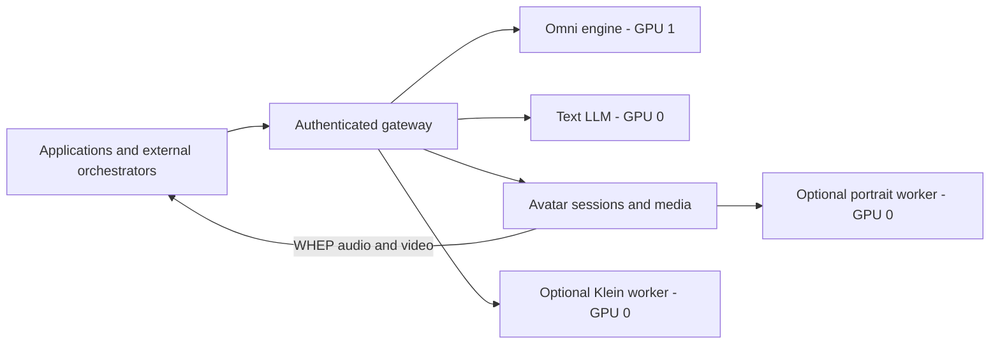

# Architecture

The repository provides shared inference and avatar services. Applications own user identity, durable memory, agent orchestration, tool authorization/execution and workspace actions.

## Service boundaries

| Directory | Owns | Runtime dependencies |
| --- | --- | --- |
| `services/gateway/` | Authentication, aliases, admission, Responses/Chat/Realtime transport and the browser demo. | Private HTTP/WebSocket engine APIs; the Avatar Unix socket. |
| `services/inference/` | Model acquisition, inference launchers, deployment configuration and patches for pinned upstream packages. | Model snapshots and upstream inference libraries. |
| `services/llm/` | Text model acquisition, launcher, Responses admission, GPU control and reasoning budget patches. | Independently pinned vLLM image and LLM snapshot. |
| `services/avatar/` | Session ownership, audio generations, playback timeline, renderer protocol and WebRTC tracks. | Optional Portrait HTTP/WS origin or local Unix socket. |
| `services/portrait/` | Reference preparation, its GPU lease and timestamped neural rendering. | Pinned Ditto code/models, isolated by a worker image. |
| `services/images/` | CPU prompt encoding, original-precision Klein inference and task-scoped GPU allocation. | Pinned Klein snapshot and Diffusers, isolated by a worker image. |

Gateway, Avatar and Portrait are Python packages with importable `app.py` factories and separate `__main__.py` process entrypoints. Imports inside a service are relative. Gateway separates environment/model policy (`config.py`), resource admission (`admission.py`), HTTP application wiring (`app.py`) and backend-specific transport clients. Cross-service communication uses the [API contract](api.md); cross-service Python imports belong in `tests/integration/` only.

`services/inference/configs/` contains model stage configuration. `patches/` contains version-checked upstream adapters and their helper. `docker/` contains CUDA/Jetson compatibility build variants; the primary inference Dockerfile stays at the service root. Container inference files are installed under `/opt/tuber-omni/`, with configuration and patch subdirectories.

The portrait frame adapter selects CUDA Graph or TensorRT through deployment configuration. `services/portrait/tensorrt_frame.py` owns target-specific engine export, cache compatibility and CUDA tensor bindings; `backend.py` owns SDK integration and frame/session lifecycle. The independent TensorRT image contains its runtime dependencies. Both frame implementations share the audio timeline, motion sampler and public Avatar contract.

## Deployment and state

`deploy/compose/` contains the base stack and composable hardware/service layers. `tools/compose.py` selects supported combinations and passes an explicit repository project directory and environment file to Docker Compose. The Compose project remains `tuber-omni-infra`, preserving existing named volumes.

The workstation assigns GPU 1 to Omni and GPU 0 to the LLM. Each inference container sees its assigned GPU as local device 0. The optional portrait worker shares GPU 0 and pools up to two independent Ditto slots for preparation and rendering. The portrait overlay runs a project-scoped CUDA MPS controller. The renderer publishes a private expiring frame clock per slot and the LLM yields to the tightest live deadline. LLM and Omni admission are independent. [Workstation budgets and evidence](deployment/workstation.md)

The optional image overlay exposes caller-owned jobs through the gateway. Its GPU coordinator fences portrait allocations, drains LLM generation, grants the image worker one GPU lease and restores LLM admission after the worker has drained. The worker receives only image inputs and exposes private preparation, execution and cancellation operations. The engine GPU controls use a separate private credential.

Weights live in ignored `data/` paths. Reference assets, features, control sockets and compiler caches use named volumes. Application credentials live in the ignored root `.env`. The wrapper anchors local paths to the repository root.

## Validation and documentation

- Service-local tests cover that service's contracts and lifecycle.
- `tests/integration/` covers gateway-to-Avatar transport with a fixture inference engine.
- `tests/tooling/` covers deployment entrypoint selection and path resolution.
- `tools/qualification/` calls real public APIs and consumes media; `tools/diagnostics/` contains model-boundary investigations.
- `evaluations/fixtures/` owns shared audio and text inputs for qualification and diagnostics; `evaluations/results/` retains real-device evidence. Each result records the code, configuration and measurement conditions of its run.

The bilingual root READMEs own project discovery and getting started. This document owns module boundaries; [API](api.md) owns wire behavior; deployment guides own operations and acceptance limits. [Development](development.md) owns local commands and checks.
