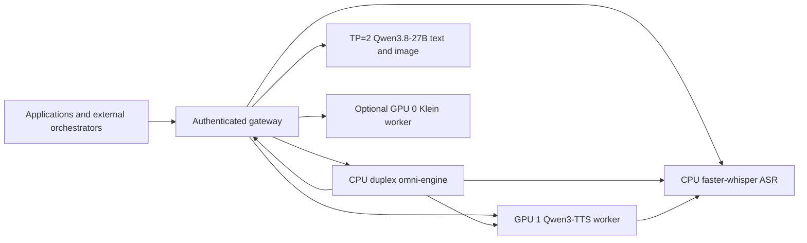

# Architecture

The repository provides shared inference services. Applications own user identity, durable memory, agent orchestration, tool authorization/execution and workspace actions.

## Service boundaries

| Directory | Owns | Runtime dependencies |
| --- | --- | --- |
| `services/gateway/` | Authentication, aliases, admission, Responses/Chat/Realtime/Speech/ASR transport and the browser demo. | Private HTTP/WebSocket engine APIs. |
| `services/omni/` | Pure-CPU engineered full-duplex orchestrator (Silero VAD ONNX + `omni-asr` + `llm-engine` + `omni-tts`), zero VRAM. | `python:3.12-slim-bookworm`, `onnxruntime`, `aiohttp`, pinned Silero VAD ONNX snapshot. |
| `services/tts/` | Zero-shot voice-cloning TTS worker (`Qwen3-TTS-12Hz-0.6B-Base` primary, optional `1.7B-Base` / CPU `Genie-TTS` slot). | `pytorch/pytorch:2.9.1-cuda12.8-cudnn9-runtime`, `faster-qwen3-tts`, bundled `speech_tokenizer`. |
| `services/asr/` | Standalone CPU offline transcription worker (`/transcribe`). | `python:3.12-slim`, `faster-whisper` (`small` + `int8`), `ffmpeg`. |
| `services/llm/` | Text-and-image model acquisition, launcher (TP=2/TP=1), Responses admission, GPU control and reasoning budget adapters. | Independently pinned `vllm/vllm-openai:v0.34.0` image and LLM snapshot (`v0.32.0` for legacy rollback). |
| `services/images/` | CPU prompt encoding, original-precision Klein inference and task-scoped GPU allocation. | Pinned Klein snapshot and Diffusers, isolated by a worker image. |
| `services/inference/` | Legacy MiniCPM-o model acquisition, launcher, configs and patches retained for `--target workstation-legacy` rollback. | Model snapshots and pinned `vllm/vllm-omni:v0.32.0-x86_64` image. |

Gateway exposes an importable `app.py` factory and a `__main__.py` process entrypoint. Imports inside a service are relative. Gateway separates environment/model policy (`config.py`), resource admission (`admission.py`), HTTP application wiring (`app.py`) and backend-specific transport clients. Cross-service communication uses the [API contract](api.md); cross-service Python imports belong in `tests/integration/` only.

`services/inference/configs/` contains model stage configuration. `patches/` contains version-checked upstream adapters and their helper. `docker/` contains CUDA/Jetson compatibility build variants; the primary inference Dockerfile stays at the service root. Container inference files are installed under `/opt/tuber-omni/`, with configuration and patch subdirectories.

## Deployment and state

### 工作站 GPU 镜像与依赖收敛

Omni、LLM 与 Klein 各自生成可独立发布的服务镜像。工作站 linux/amd64 的 LLM 使用固定 vLLM OpenAI 基座，另两项使用固定 vLLM-Omni 基座。逐层比较 registry manifest，文本基座的 **39 个有序层是 Omni 基座 45 层的完整前缀**。共享部分压缩大小为 9,205,725,001 B，Omni 增量为 749,244,900 B。同一平台和 Docker 内容存储可复用这些块；单独部署 LLM 也可省去 Omni 增量。模型卷、编译缓存及跨机器的独立镜像存储另计。固定摘要见 [LLM Dockerfile](../services/llm/Dockerfile) 和 [工作站清单](../deploy/compose/workstation.yml)。

以下数据来自 2026-11-18 双 3090 工作站拆分前四个运行中容器的**实际解释器**。共同版本为 Python 3.12.3、Torch 2.13.0+cu130、Torch CUDA 13.0、CUDA Runtime 13.0.96、Triton 3.7.1。四个进程的 Torch 均来自系统包目录。

| 服务 | 观察到的版本／冲突 | 构建决策 |
| --- | --- | --- |
| Omni | vLLM 和 vLLM-Omni 均为 0.32.0，Diffusers 0.40.0，Transformers 5.19.0。MiniCPM 使用服务专属 vocoder 及上游源码补丁。 | 保留固定 Omni 层，仅在该服务镜像中安装 vocoder 和 MiniCPM 补丁。 |
| LLM | 现行工作站与 Omni 使用同一套 CUDA/Torch；文本服务需要 Qwen 解析、Responses 容量及预算补丁。 | 从共享层前缀派生，补丁直接作用于自己的 vLLM 文件，独立 fetch／serve。 |
| Klein | Diffusers 0.37.0 与 Omni 精确依赖 0.40.0 冲突；Pillow 12.2.0、aiohttp 3.13.5 分别低于 vLLM 声明的 12.3.0、3.14.3 下限。旧镜像的 aiohttp 还要求 multidict <7，实际为 7.1.0。 | 独立 `/opt/klein-env` 复用 Torch，以私有小包覆盖 Diffusers、Pillow、aiohttp、multidict。此解释器仅用于图像 worker；不以它启动 vLLM。 |

元数据审计还检出共同的 NCCL 差异（Torch 声明 2.29.7，安装 2.30.7）、OpenTelemetry SDK 差异（exporter 要求 ~=1.45.1，安装 1.40.0）。拆分前 Omni、LLM 和 Klein 镜像中的 step-audio2 声明 librosa，环境中缺少该包；拆出的 LLM 和 Klein 构建没有该 vocoder 安装步骤。上述差异需结合实际使用的运算路径验收，变更共同 ABI 须复测模型与媒体。Orin 的 ARM64、JetPack 和 CUDA 12.9 适配单独固定。

磁盘基线取自同一宿主 `docker system df -v`。旧 Klein 镜像显示 35.4 GB、独占 101.5 MB；旧 Portrait TRT 显示 44.4 GB、独占 8.489 GB。旧 TRT 安装步骤在 `docker history` 中占 4.67 GB，位于服务源码之后。新的多阶段 Dockerfile 将其移到源码之前，使仅修改 Python 文件的构建可复用该层。以上宿主数值描述当时保留的镜像与回滚标签；新增配置的磁盘收益须在相同标签集合、同一存储驱动下测量。

在本地 WSL2 的 linux/amd64 Docker 中已分别构建 Omni、LLM、Klein、Portrait CUDA Graph 和 Portrait TensorRT。五个标签同时存在时，LLM 显示 23.4 GB，其中独占 177.1 kB；Klein 独占 86.42 MB。Portrait 两个变体共享 25.25 GB，TRT 变体独占 4.665 GB，标准变体可单独拉取。TRT 容器离线导入 TensorRT 11.4.0.106 成功，Torch 来自基座的系统包目录。这里的独占量取决于本机保留的其他镜像；空节点只部署一个服务时，仍需下载它的全部基础层。 当时工作站的 Omni、LLM、Klein 与 Portrait TRT 四个运行镜像按 digest 核对，共享连续的 40 个底层文件系统层。[部署镜像与层数](../evaluations/results/infra-thermal-tuning-workstation.json)

复核时用 `docker exec -i <container> <worker-python> -B - < tools/diagnostics/runtime_dependencies.py` 检查实际解释器，并对照 `docker image inspect` 的 RootFS.Layers、`docker history` 与 `docker system df -v`。随后验证 Omni duplex、LLM Responses和 Klein 图像输出。依赖声明、导入检查与完整 GPU 推理分别记录。

`deploy/compose/` contains the base stack and composable hardware/service layers. `tools/compose.py` selects supported combinations and passes an explicit repository project directory and environment file to Docker Compose. The Compose project remains `tuber-omni-infra`, preserving existing named volumes.

The default `--target workstation` profile implements the Personal-Agent-First Dual-3090 layout:
- `llm-engine` (`RedHatAI/Qwen3.8-27B-INT4@71dface38d4cbfa34121f1d446d4a0fa1025f13c` on `vllm/vllm-openai:v0.34.0`) spans GPU 0 and GPU 1 (`TP=2`, `gpu_memory_utilization=0.80`).
- `omni-tts` (`Qwen/Qwen3-TTS-12Hz-0.6B-Base@5d83992436eae1d760afd27aff78a71d676296fc`) resides on GPU 1 (`TTS_GPU_DEVICE=1`), or runs CPU-only via `TTS_BACKEND=genie`.
- `omni-engine` (`omni-api-duplex:1.0`, Silero VAD ONNX `@e71cae966052b992a7eca6b17738916ce0eca4ec`) and `omni-asr` (`faster-whisper` `small` `int8`) run on CPU (0 MiB VRAM).
- Optional `--images` places Klein 4B on GPU 0 (`IMAGE_GPU_DEVICE=0`, away from `omni-tts` on GPU 1) and coordinates TP=2 KV release / weight offload via `gpu-switch`.
- `--target workstation-legacy` keeps the prior single-GPU `Qwen3.5-9B + MiniCPM-o-4_5` layout intact for one-command rollback. [Workstation deployment](deployment/workstation.md)

The optional image overlay exposes caller-owned jobs through the gateway. In the colocated profile its coordinator drains LLM generation, releases KV or offloads LLM weights across TP=2 (`OMNI_IMAGE_LLM_SLEEP_STRATEGY=auto`), grants the image worker one GPU lease, and restores LLM admission after the worker has drained. A dedicated image worker has its own device allocation and accepts private HTTP calls from the gateway. The gateway owns the job queue and results in both modes.

Weights live in ignored `data/` paths. Control sockets and compiler caches use named volumes. Application credentials live in the ignored root `.env`. The wrapper anchors local paths to the repository root.

## Validation and documentation

- Service-local tests cover that service's contracts and lifecycle.
- `tests/integration/` covers gateway-to-image-worker routing and job ownership.
- `tests/tooling/` covers deployment entrypoint selection and path resolution.
- `tools/qualification/` calls real public APIs and consumes media; `tools/diagnostics/` contains model-boundary investigations.
- `evaluations/fixtures/` owns shared audio and text inputs for qualification and diagnostics; `evaluations/results/` retains real-device evidence. Each result records the code, configuration and measurement conditions of its run.

The bilingual root READMEs own project discovery and getting started. This document owns module boundaries; [API](api.md) owns wire behavior; deployment guides own operations and acceptance limits. [Development](development.md) owns local commands and checks.
